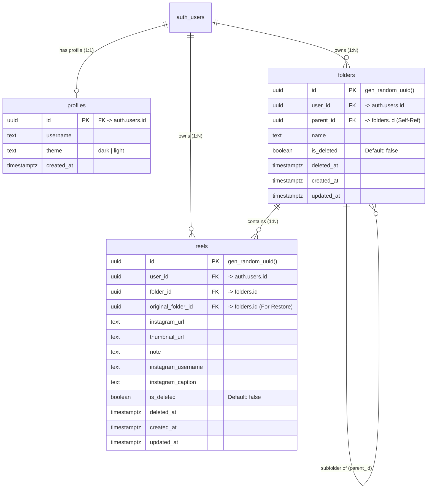

# 🎬 Reel Manager — Complete System Context & Technical Specification

> **Document Type:** Project Report Context & System Specification Document  
> **Target Audience:** AI Agents, Technical Authors, Software Architects, Academic Evaluators  
> **Project Version:** v2.3 (Production Monorepo)  
> **Repository:** `Reel_Manager`  
> **Architecture:** Monorepo (React 19 + Express 5 + Chrome Extension Manifest V3 + Supabase PostgreSQL + Python Scraper)

---

## 1. Executive Summary & Project Overview

### 1.1 Problem Statement
Instagram is the world's leading short-form video platform, with hundreds of millions of Reels consumed daily. Users constantly encounter high-utility educational content, recipes, technical tutorials, UI/UX inspirations, and creative ideas. However, Instagram's native "Saved" collection features suffer from severe limitations:
- **Cluttered & Inflexible Organization:** Instagram collections offer basic single-level buckets with poor search, no nested hierarchy, and cumbersome management.
- **Wasted Context:** Users cannot attach personal notes, code snippets, tags, or summaries to saved reels.
- **Link Rot & Broken References:** Reels get deleted or accounts change handles, leaving users with cryptic broken links.
- **Disjointed Browsing Experience:** Browsing native saved posts forces users into continuous infinite-scroll feeds rather than an intentional, organized workspace.

### 1.2 Solution: Reel Manager
**Reel Manager** is a developer-grade, visual knowledge and bookmarking platform engineered specifically for Instagram Reels. Drawing design inspiration from **Vercel's monochromatic luxury minimalism** and **Obsidian's visual card hierarchies**, Reel Manager turns fleeting social media media into an actionable, structured, and searchable personal library.

### 1.3 Key Value Propositions
1. **Visual Flashcard Experience (9:16 Ratio):** Every saved Reel is rendered as a clean, high-contrast portrait flashcard mimicking the video's original aspect ratio.
2. **Deep Folder & Subfolder Hierarchies:** Organize reels by domains (e.g., *Frontend Engineering*, *System Architecture*, *Cooking & Recipes*, *Gym Workouts*) with unlimited nested subfolders and fast search.
3. **Seamless In-Browser Capture (Chrome Extension):** A custom Manifest V3 companion extension injects an isolated Shadow DOM drawer directly into `instagram.com`, featuring one-click folder saving, live duplicate detection, and an HTML5 canvas video frame snapshotter.
4. **Zero-Login Extension Synchronization:** A background web-app bridge detects logged-in Supabase sessions from the web client (`localhost` or `vercel.app`) and automatically syncs authentication tokens to the extension storage without requiring redundant logins.
5. **Multi-Tier Thumbnail Extraction Engine:** Instagram's strict CORS and rate-limiting barriers are bypassed using a 4-tier fallback ingestion pipeline (Graph API $\rightarrow$ Python Instaloader Subprocess $\rightarrow$ oEmbed API $\rightarrow$ Curated Unsplash Placeholders) complemented by a backend reverse-image proxy.
6. **Safety & Data Retention (Recycle Bin):** Soft deletion retains removed folders and reels for 7 days with single and batch restoration back to their original folder locations.

---

## 2. Technology Stack & Architectural Overview

Reel Manager is structured as an **npm workspaces monorepo** consisting of three interconnected packages, a cloud PostgreSQL database layer, and a dedicated Python scraping engine.

```
+-------------------------------------------------------------------------------+
|                               REEL MANAGER ECOSYSTEM                          |
+------------------------------------+------------------------------------------+
                                     |
    +--------------------------------+--------------------------------+
    |                                |                                |
    v                                v                                v
+------------------------+  +------------------------+  +------------------------+
|   Frontend Client      |  |   Backend API Server   |  |   Chrome Extension     |
|   (@reel-manager/      |  |   (@reel-manager/      |  |   (@reel-manager/      |
|    frontend)           |  |    backend)            |  |    extension)          |
|                        |  |                        |  |                        |
| - React 19 + Vite      |  | - Node.js + Express 5  |  | - Manifest V3          |
| - TypeScript           |  | - TypeScript (tsx)     |  | - Instagram Content    |
| - Tailwind CSS v4      |  | - CORS Proxy Engine    |  |   Script (Shadow DOM)  |
| - Lucide React         |  | - Python Instaloader   |  | - Video Frame Canvas   |
| - React Router v6      |  |   Subprocess Engine    |  |   Snapshotter          |
| - Supabase JS SDK      |  | - Duplicate Cache (TTL)|  | - WebApp Bridge Sync   |
+-----------+------------+  +-----------+------------+  +-----------+------------+
            |                           |                           |
            |                           |                           |
            +---------------------+     |     +---------------------+
                                  |     |     |
                                  v     v     v
                  +----------------------------------------------+
                  |            Supabase BaaS / Database          |
                  |                                              |
                  | - PostgreSQL 15                              |
                  | - Row Level Security (RLS)                   |
                  | - Supabase Auth (Email + Google OAuth 2.0)   |
                  | - Automated Triggers (User Profile Creation) |
                  | - Soft Delete Constraints                    |
                  +----------------------------------------------+
```

### 2.1 Detailed Technology Matrix

| Layer | Technology | Version | Purpose & Rationale |
|---|---|---|---|
| **Monorepo Orchestrator** | npm Workspaces | v10+ | Unified dependency management, concurrent script orchestration via `concurrently`. |
| **Frontend Framework** | React | `19.2.4` | Modern UI rendering with concurrent features and optimal hydration. |
| **Frontend Tooling** | Vite | `5.4.11` | Sub-millisecond HMR, lightning-fast dev server, and optimized production builds. |
| **Styling & Design System** | Tailwind CSS v4 + Vanilla CSS | `4.0.0` | High-contrast monochromatic Vercel theme tokens, Geist fonts, CSS variables. |
| **Client Routing** | React Router DOM | `6.22.3` | SPA navigation, dynamic folder routing (`/folder/:folderId`), protected routes. |
| **Iconography** | Lucide React | `1.17.0` | Crisp, developer-grade iconography matching modern dashboard aesthetics. |
| **Backend Runtime** | Node.js + Express | Express `5.2.1` | REST API handling image proxying, duplicate checks, and scraper coordination. |
| **Backend Execution** | `tsx` | `4.19.3` | Native TypeScript execution engine with file watching (`tsx watch`). |
| **Scraper Subprocess** | Python 3 + `instaloader` | Python 3.10+ | Headless metadata extraction and disk caching of high-resolution video covers. |
| **Database & Auth** | Supabase (PostgreSQL) | Latest | Managed PostgreSQL with RLS, GoTrue Auth (Email/Pass + Google OAuth), automated triggers. |
| **Browser Extension** | Chrome Extensions API | Manifest V3 | Side-by-side dock drawer inside Instagram, HTML5 video frame grabber, storage sync. |
| **Deployment & Hosting** | Vercel | Multi-service | Unified monorepo deployment with reverse-proxy routing between frontend Vite & backend Express. |

---

## 3. Directory & Repository Architecture

```text
Reel_Manager/
├── .agents/                        # Agent workflows and skill configurations
├── .venv/                          # Local Python virtual environment for Instaloader
├── package.json                    # Monorepo root configuration (npm workspaces)
├── vercel.json                     # Vercel multi-service routing and SPA rewrite rules
├── README.md                       # High-level overview & quickstart guide
├── PROJECT_REPORT_CONTEXT.md       # Full comprehensive specification (this document)
│
├── frontend/                       # React 19 Client Application
│   ├── public/                     # Static assets and cached thumbnail files
│   │   └── thumbnails/             # Locally cached Reel cover images (.jpg + .json)
│   ├── src/
│   │   ├── components/
│   │   │   ├── ContextMenu/        # Custom right-click floating menu (Rename, Delete, Edit)
│   │   │   └── Layout/             # Master Layout: Collapsible Sidebar, Header, User Modal
│   │   ├── constants/              # Centralized route strings, API endpoints, UI tokens
│   │   ├── contexts/
│   │   │   ├── AppContext.tsx      # Global state: Auth user, Folders, Theme, Search query
│   │   │   └── ContextMenuContext.tsx # Global coordinates and actions for right-click menus
│   │   ├── hooks/
│   │   │   └── useContextMenu.ts   # Custom hook binding context menus to interactive cards
│   │   ├── lib/supabase/
│   │   │   └── client.ts           # Supabase JS singleton client initialization
│   │   ├── pages/
│   │   │   ├── Dashboard.tsx       # Folder Grid View, stats, quick-folder creation
│   │   │   ├── Folder.tsx          # 9:16 Reel Flashcard Grid, Subfolders, In-line editing
│   │   │   ├── Login.tsx           # Email/Password + Google OAuth login & registration
│   │   │   ├── PrivacyPolicy.tsx   # Compliance and OAuth privacy disclosures
│   │   │   ├── RecycleBin.tsx      # 7-day soft-delete holding bin with batch recovery
│   │   │   └── ResetPassword.tsx   # Password recovery and reset confirmation
│   │   ├── types/                  # TypeScript interface definitions (Reel, Folder, Profile)
│   │   ├── utils/
│   │   │   └── logger.ts           # Environment-aware console logging abstraction
│   │   ├── App.tsx                 # Root Router, Protected/Public Route wrappers, Error Boundary
│   │   ├── index.css               # Design tokens, CSS variables, dark/light Vercel theme
│   │   └── main.tsx                # React DOM mounting entrypoint
│   ├── vite.config.ts              # Vite configuration with `/api` reverse proxy to Express
│   └── tsconfig.json               # Frontend TypeScript configuration
│
├── backend/                        # Express 5 (TypeScript) API Server
│   ├── scripts/
│   │   └── get_thumbnail.py        # Python Instaloader scraper & disk metadata cache
│   ├── src/
│   │   ├── controllers/
│   │   │   ├── duplicate.controller.ts # Duplicate checking controller
│   │   │   ├── proxy.controller.ts     # CORS bypass reverse image proxy controller
│   │   │   └── thumbnail.controller.ts # Reel thumbnail & metadata controller
│   │   ├── routes/
│   │   │   └── api.routes.ts       # Route registrations (/api/health, /api/proxy-image, etc.)
│   │   ├── services/
│   │   │   ├── duplicate.service.ts    # Shortcode parser, Supabase REST & in-memory cache
│   │   │   └── thumbnail.service.ts    # Orchestrator for Graph API, Python, and oEmbed
│   │   ├── app.ts                  # Express server middlewares, CORS, JSON parsers
│   │   └── server.ts               # HTTP bootstrap listening on PORT 5000
│   └── tsconfig.json               # Backend TypeScript configuration
│
├── extension/                      # Chrome Extension (Manifest V3)
│   ├── scripts/
│   │   └── generate-icons.js       # Dynamic icon asset generator (16px, 32px, 48px, 128px)
│   ├── src/
│   │   ├── background/
│   │   │   └── background.ts       # Service worker: message routing, storage, tab notification
│   │   ├── config/
│   │   │   └── supabase.ts         # Direct Supabase REST fetch client for extension actions
│   │   ├── content/
│   │   │   ├── instagram.ts        # DOM observer, active video detector, canvas snapshotter
│   │   │   ├── queue.ts            # Queue management for rapid multi-reel saving
│   │   │   ├── sidebar.css         # Isolated CSS styles injected into Shadow DOM
│   │   │   ├── sidebar.ts          # Draggable, dockable UI drawer component
│   │   │   └── webapp-bridge.ts    # Content script auto-syncing session from localhost/vercel
│   │   ├── popup/
│   │   │   ├── popup.html          # Toolbar popup interface
│   │   │   ├── popup.css           # Toolbar styling
│   │   │   └── popup.ts            # Toolbar controller & session inspector
│   │   └── types/                  # Shared extension type interfaces
│   ├── manifest.json               # Manifest V3 specification
│   └── vite.config.ts              # Extension bundler generating unpacked extension files
│
├── database/                       # Database Schemas & Migrations
│   ├── supabase_schema.sql         # Base PostgreSQL schema (tables, RLS, triggers)
│   ├── supabase_update.sql         # Patch migration (subfolders, soft-delete, instagram meta)
│   └── check_db.js                 # Database health diagnostic script
│
└── docs/                           # Documentation & Specifications
    ├── DESIGN.md                   # Vercel aesthetic tokens and typography guidelines
    └── reel-manager-stitch-prompt.md # Comprehensive UI specification and flow rules
```

---

## 4. Comprehensive Feature Breakdown

### 4.1 Authentication & Profile System
- **Supabase GoTrue Integration:** Full authentication cycle handling user registration, login, logout, and password recovery.
- **Google OAuth 2.0 Flow:** One-click Google sign-in configured via Supabase OAuth credentials.
  - Automatically exchanges authorization code on OAuth callback (`exchangeCodeForSession(code)` in `AppContext.tsx`).
  - Cleans up browser URL history seamlessly without leaving ugly query parameters.
- **Automated Profile Trigger:** An idempotent PostgreSQL trigger (`handle_new_user`) automatically provisions a `profiles` record whenever a new user signs up in `auth.users`, initializing default username and theme preferences.
- **User Account Modal:** Located in the sidebar footer:
  - **Profile Management:** Update display username and upload custom avatar.
  - **In-Browser Image Resizer:** Custom avatar uploads are automatically downscaled and cropped using an HTML5 Canvas into a compact 96x96 JPEG base64 string, preventing unnecessary cloud storage bloat.
  - **Security Tab:** Change email address and update user account passwords directly.
- **Session Expiration Guard:** Implements automated 6-hour session expiration validation for heightened client security.

### 4.2 Folder Organization & Subfolder Hierarchy
- **Nested Folder Structure:** Supports unlimited subfolder creation via `parent_id` foreign key relationships pointing recursively to `public.folders(id)`.
- **High-Performance Aggregation (O(N)):**
  - Instead of executing $N$ separate database calls to count reels inside each folder, the frontend queries all user reel folder IDs in one batch and performs an $O(N)$ frequency map reduction in memory.
- **Folder Filtering & Search:** Real-time client-side search bar filters folders instantly by title across the dashboard.
- **Folder Action Modals:**
  - Create Folder & Create Subfolder dialogs.
  - Rename Folder dialog with input sanitization.
  - Folder Properties Modal displaying creation date, last updated date, item count, and database identifier.
  - Soft-delete with cascading protection.

### 4.3 9:16 Portrait Reel Flashcard Experience
- **Vercel-Grade Card Aesthetics:** Cards are constructed with strict 9:16 portrait ratios matching mobile video dimensions, encased in high-contrast `#2A2A2A` borders with smooth scale and border-glow hover micro-animations.
- **Rich Media & Metadata Display:**
  - High-resolution poster cover.
  - Instagram handle badge (`@username`) overlaid on the card.
  - Original caption preview with truncation.
  - Custom user notes section displayed prominently beneath the card.
- **Interactive Inline Note Editing:** Double-clicking any card note converts the text into an active inline `<textarea>`, updating the record in Supabase upon pressing `Enter` or blurring the input.
- **Detailed Reel Properties Modal:** Provides comprehensive metadata inspection including original Instagram URL, shortcode, creation timestamp, last modified timestamp, parent folder reference, and direct link actions.
- **Quick Instagram Launch:** Clicking the thumbnail opens the live Reel on Instagram in a new browser tab with strict `noopener,noreferrer` security flags.

### 4.4 Real-Time Duplicate Detection Engine
To eliminate redundant bookmarking across different folders:
1. **Shortcode Normalization:** A robust regex parses variations of Instagram links:
   - `instagram.com/reel/C123456/`
   - `instagram.com/reels/C123456/`
   - `instagram.com/p/C123456/`
   - `instagram.com/share/reel/C123456/`
   - Raw shortcodes (e.g. `C123456`).
2. **Backend Verification Service (`/api/check-duplicate`):**
   - Direct Node.js fetch against the Supabase REST API (`reels?instagram_url=ilike.*SHORTCODE*&is_deleted=eq.false`).
   - Strict 3.5-second timeout with abort controller to avoid thread blocking.
   - **In-Memory Cache (TTL 5 Minutes):** Caches shortcode lookup results to prevent rate limits and repetitive DB roundtrips.
3. **Proactive UI Feedback:**
   - When entering a URL in the "Add Reel" modal, a debounced check runs in the background.
   - If the reel already exists in another folder, an amber warning banner appears showing the exact folder name where it is currently stored:
     > *"⚠️ This reel is already saved in your folder: **Design Inspiration**"*
   - The user can still intentionally save it or cancel to avoid duplicate clutter.

### 4.5 Quad-Engine Media Ingestion Pipeline
Fetching media from Instagram is notoriously difficult due to CORS restrictions, IP rate limits, and short-lived media CDN tokens. Reel Manager solves this with a 4-tier fallback pipeline:

```
User inputs Reel URL
         │
         ▼
[Engine 1: Instagram Graph API] ──(Valid Access Token?)──► Fetches high-res media URL
         │ (Fails / No Token)
         ▼
[Engine 2: Python Instaloader Subprocess] ───────────────► Scrapes high-res cover,
         │                                                 downloads to public/thumbnails/
         │ (Fails / Rate-limited)
         ▼
[Engine 3: Instagram oEmbed API] ────────────────────────► Fetches official public thumbnail
         │ (Fails / Private post)
         ▼
[Engine 4: Curated Unsplash Placeholders] ───────────────► Assigns sleek abstract art cover
```

- **Reverse Image Proxy (`/api/proxy-image?url=...`):**
  - Instagram CDN images block external browser referrers (`403 Forbidden`).
  - The Express proxy fetches the image server-side, strips the `Referer` header, injects caching headers (`Cache-Control: public, max-age=86400`), and streams the binary image directly to the client.

### 4.6 Soft Delete & 7-Day Recycle Bin
- **Two-Stage Deletion Model:** Deleting a reel or folder sets `is_deleted = true`, stamps `deleted_at = NOW()`, and records `original_folder_id = folder_id`.
- **7-Day Retention Window:** The Recycle Bin UI displays days remaining before auto-purge for each item.
- **Batch & Single Restore Operations:**
  - Select individual cards or use "Select All" checkboxes to restore items in bulk.
  - Restoring a card returns it directly to its `original_folder_id`. If the parent folder was also deleted, it restores gracefully to the root Dashboard level.
- **Permanent Purge:** Users can permanently delete selected items or execute "Empty Recycle Bin" to purge all deleted records permanently.

### 4.7 Companion Chrome Extension (Manifest V3)
- **Shadow DOM Isolation:** Injects the sliding dock drawer (`#reel-manager-root`) into `instagram.com` wrapped in a closed Shadow DOM. This guarantees that Instagram's global styles and CSS variables never distort or corrupt the Reel Manager UI.
- **Live Video Frame Capture (`captureVideoFrame`):**
  - When viewing a reel, clicking "Snap Frame" paints the active HTML5 `<video>` element directly onto an off-screen `<canvas>`.
  - Exports a crisp 360x640 JPEG data URL in portrait ratio, giving the user an instant, accurate cover even for private reels or unindexed posts.
- **Real-Time Extension Duplicate Badge:** The extension sidebar highlights whether the currently viewed Reel on Instagram has already been saved to your Reel Manager, showing the destination folder.
- **Web App Bridge (`webapp-bridge.ts`):**
  - Runs in the background of `http://localhost:*`, `http://127.0.0.1:*`, and `https://*.vercel.app/*`.
  - Automatically queries `localStorage` for active Supabase GoTrue session tokens (`sb-*-auth-token`).
  - Seamlessly transmits the active JWT to the extension background service worker via `chrome.runtime.sendMessage({ type: 'SYNC_SESSION' })`.
  - Result: The user logs in once on the web application and is **instantly logged into the Chrome extension** without entering credentials twice.
- **Draggable Quick-Launch Tab:** A floating circular button floats on Instagram. Users can drag and position it anywhere along the viewport edges; its coordinates are saved to `localStorage` (`rm_tab_pos`).

### 4.8 Context Menu & Accessibility
- **Global Context Menu Provider:** Right-clicking any folder or reel card triggers a custom floating menu with keyboard accessibility:
  - *Edit Reel / Rename Folder*
  - *View Properties*
  - *Open on Instagram*
  - *Move to Folder*
  - *Delete (Move to Recycle Bin)*
- **Theme Engine:** Instant switching between Dark and Light mode. The selected theme is persisted both in `document.documentElement` (`data-theme`) and synced to the user's Supabase profile in the cloud.

---

## 5. Database Schema & Data Models

The database is built on **Supabase PostgreSQL 15** with Row Level Security (RLS) enabled on all tables.

### 5.1 Entity-Relationship (ER) Diagram



### 5.2 Row Level Security (RLS) Policies
Every table is locked down with PostgreSQL RLS:
```sql
ALTER TABLE public.profiles ENABLE ROW LEVEL SECURITY;
ALTER TABLE public.folders ENABLE ROW LEVEL SECURITY;
ALTER TABLE public.reels ENABLE ROW LEVEL SECURITY;

-- Profiles: Users can only read and update their own profile row
CREATE POLICY "Users own their profiles" ON public.profiles 
  FOR ALL USING (auth.uid() = id);

-- Folders: Complete isolation per authenticated user_id
CREATE POLICY "Users own their folders" ON public.folders 
  FOR ALL USING (auth.uid() = user_id);

-- Reels: Complete isolation per authenticated user_id
CREATE POLICY "Users own their reels" ON public.reels 
  FOR ALL USING (auth.uid() = user_id);
```

### 5.3 Automated New User Provisioning Trigger
```sql
CREATE OR REPLACE FUNCTION public.handle_new_user()
RETURNS TRIGGER AS $$
BEGIN
  INSERT INTO public.profiles (id, username, theme)
  VALUES (
    new.id, 
    COALESCE(new.raw_user_meta_data->>'username', split_part(new.email, '@', 1)), 
    'dark'
  );
  RETURN NEW;
END;
$$ LANGUAGE plpgsql SECURITY DEFINER;

CREATE TRIGGER on_auth_user_created
  AFTER INSERT ON auth.users
  FOR EACH ROW EXECUTE FUNCTION public.handle_new_user();
```

---

## 6. Backend API & Inter-Process Specifications

### 6.1 REST Endpoints

#### 1. System Health & Status
- **Route:** `GET /api` & `GET /api/health`
- **Response:**
  ```json
  {
    "status": "ok",
    "service": "reel-manager-backend",
    "version": "2.3",
    "timestamp": "2026-10-27T12:00:00.000Z"
  }
  ```

#### 2. Reverse Image Proxy
- **Route:** `GET /api/proxy-image?url=<ENCODED_IMAGE_URL>`
- **Description:** Bypasses CORS and referrer-policy rejections on Instagram CDN assets.
- **Headers Sent:** `User-Agent: Mozilla/5.0...`, `Accept: image/avif,image/webp,image/apng,image/*,*/*;q=0.8`
- **Response:** Binary image buffer with matching `Content-Type` and `Cache-Control: public, max-age=86400`. Fallbacks to redirect if non-image.

#### 3. Thumbnail Scraper
- **Route:** `POST /api/thumbnail`
- **Payload:**
  ```json
  {
    "url": "https://www.instagram.com/reel/DC5bXv8y..."
  }
  ```
- **Response:**
  ```json
  {
    "thumbnail": "/thumbnails/DC5bXv8y.jpg",
    "username": "developer_tips",
    "caption": "10 React performance tips you must know..."
  }
  ```

#### 4. Duplicate Reel Checker
- **Route:** `POST /api/check-duplicate` or `GET /api/check-duplicate?url=...&user_id=...`
- **Payload:**
  ```json
  {
    "url": "https://www.instagram.com/reel/DC5bXv8y...",
    "user_id": "uuid-v4-string"
  }
  ```
- **Response (Duplicate Found):**
  ```json
  {
    "isDuplicate": true,
    "shortcode": "DC5bXv8y",
    "folderName": "Frontend Inspiration",
    "folderId": "3845a7b4-...",
    "reelId": "f901c23a-...",
    "matchedUrl": "https://www.instagram.com/reel/DC5bXv8y/"
  }
  ```
- **Response (Not Duplicate):**
  ```json
  {
    "isDuplicate": false,
    "shortcode": "DC5bXv8y"
  }
  ```

---

## 7. Design System & Aesthetics (Vercel Monochromatic Luxury)

Reel Manager strictly implements the Vercel design system tokens defined in `src/index.css` and `docs/DESIGN.md`:

### 7.1 Color Tokens
| CSS Token | Dark Mode (Default) | Light Mode | Application |
|---|---|---|---|
| `--bg-base` | `#000000` | `#FFFFFF` | Core application canvas background |
| `--bg-surface` | `#0A0A0A` | `#FAFAFA` | Sidebars, drawers, layout containers |
| `--bg-elevated` | `#111111` | `#F2F2F2` | Form inputs, search fields, active pills |
| `--bg-card` | `#141414` | `#FFFFFF` | Reel flashcards, folder cards, modals |
| `--border-default` | `#2A2A2A` | `#EAEAEA` | Primary outlines, card borders |
| `--border-subtle` | `#1C1C1C` | `#F0F0F0` | Dividers, subtle separator lines |
| `--text-primary` | `#EDEDED` | `#111111` | Primary titles, headlines, card labels |
| `--text-secondary` | `#888888` | `#666666` | Descriptions, timestamps, secondary labels |
| `--text-muted` | `#555555` | `#AAAAAA` | Placeholders, inactive breadcrumbs |
| `--accent` | `#FFFFFF` | `#000000` | High-emphasis action buttons, focus rings |
| `--destructive` | `#FF4444` | `#CC0000` | Delete buttons, error badges, warnings |

### 7.2 Typography Guidelines
- **Primary Typography:** `"Geist", "Inter", -apple-system, sans-serif`
- **Monospace Code/IDs:** `"Geist Mono", "Fira Code", monospace`
- **Card Titles:** 16px–18px, weight 600, letter spacing `-0.01em`
- **Labels / Badges:** 11px–12px, weight 500, uppercase, letter spacing `0.04em`

---

## 8. Deployment, Production Routing & DevOps

### 8.1 Vercel Multi-Service Monorepo Architecture
Reel Manager uses Vercel's multi-service deployment pattern via `vercel.json`:
- **Frontend Service:** Managed Vite project rooted at `/frontend`.
- **Backend Service:** Managed Express project rooted at `/backend`.
- **Traffic Routing:**
  - Requests matching `/api/(.*)` route directly to the Express backend service.
  - Asset requests matching `/assets/(.*)` or static file extensions route to Vite's static build output.
  - All remaining routes rewrite to `/index.html`, enabling client-side SPA routing and OAuth code handling without 404 errors.

### 8.2 Environment Configuration Reference
```env
# Supabase Configuration
NEXT_PUBLIC_SUPABASE_URL=https://your-project-id.supabase.co
NEXT_PUBLIC_SUPABASE_ANON_KEY=your-supabase-anon-key
NEXT_PUBLIC_SUPABASE_PUBLISHABLE_KEY=your-supabase-anon-key

# Backend Server Configuration
PORT=5000
INSTAGRAM_OEMBED_TOKEN=your-facebook-graph-api-token # (Optional)
PYTHON_PATH=.venv/Scripts/python.exe # (Optional custom path)
```

---

## 9. Recommended Project Report Structure for Agents

When generating an academic, technical, or industrial project report from this context, follow this recommended outline:

1. **Chapter 1: Introduction**
   - 1.1 Context and Motivation (The rise of short-form educational video).
   - 1.2 Problem Definition (Disorganized bookmarks, link rot, lack of note-taking).
   - 1.3 Project Objectives & Scope.
2. **Chapter 2: Literature Review & Related Work**
   - 2.1 Review of Existing Solutions (Instagram native saves, Pinterest, Notion, Pocket).
   - 2.2 Comparative Feature Analysis.
3. **Chapter 3: System Requirements & Feasibility**
   - 3.1 Functional Requirements (Auth, Folders, 9:16 Flashcards, Extension, Recycle Bin).
   - 3.2 Non-Functional Requirements (Security, Performance, CORS resilience, Low latency).
4. **Chapter 4: Architectural Design & Engineering**
   - 4.1 High-Level Architecture (Workspaces Monorepo).
   - 4.2 Database Modeling & Entity-Relationship Specifications (RLS, Triggers).
   - 4.3 Media Ingestion Pipeline (Graph API, Python Instaloader, oEmbed, Canvas Frame Capturer).
   - 4.4 Chrome Extension Manifest V3 & Shadow DOM Isolation.
5. **Chapter 5: Implementation Details & Code Highlights**
   - 5.1 React 19 Frontend & Tailwind v4 Monochromatic Design System.
   - 5.2 Real-Time Duplicate Prevention & In-Memory TTL Cache.
   - 5.3 Web App Session Bridge to Extension Storage.
   - 5.4 Soft Deletion & 7-Day Lifecycle Management.
6. **Chapter 6: Testing, Optimization & Security**
   - 6.1 Performance Optimizations (O(N) folder count reduction, Vite bundling).
   - 6.2 Security Analysis (Row Level Security verification, Canvas sanitization, Token hygiene).
7. **Chapter 7: Results, Evaluation & User Experience**
   - 7.1 User Interface Showcase (Dashboard, Folder View, Modals, Extension Dock).
   - 7.2 Performance Benchmarks and Ingestion Success Rates.
8. **Chapter 8: Conclusion & Future Roadmap**
   - 8.1 Summary of Achievements.
   - 8.2 Future Enhancements (AI semantic search, automatic video transcription, offline PWA).
