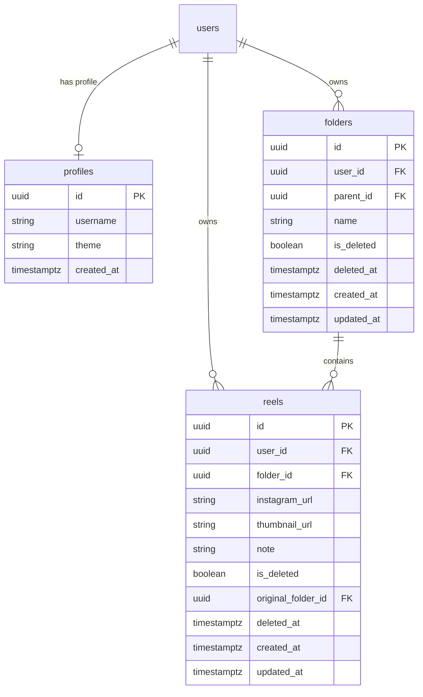

# 🎬 Reel Manager

A sleek, premium, developer-grade web application to save, organize, and browse Instagram Reel links in a visual flashcard-and-folder system. Inspired by **Vercel's** clean monochromatic aesthetic and **Obsidian's** card layouts, Reel Manager acts as a personal Pinterest board built specifically for Reels.


---

## ✨ Features

- **🔐 Supabase Authentication & Profile System**
  - Sign in or sign up securely using email and password.
  - Automatic profile generation on signup.
  - Automatic 6-hour session expiration check for security.

- **📁 Nested Folder Organization**
  - Create and manage folder groups for different topics (e.g., *Recipes*, *Design Inspiration*, *Workouts*).
  - Quick-search filter for folders.
  - Breadcrumb and browser-compatible navigation history with custom back/forward UI controls.

- **📸 Portrait-Ratio Reel Flashcards (9:16)**
  - Hover effects with premium Vercel-like hover borders and card outlines.
  - Click to play the Reel directly on Instagram.
  - **Inline Editing**: Double-click any note on a card to edit and update it directly in the database.

- **⚡ Dual-Engine Thumbnail Scraper & Proxy**
  - Uses a **Python script with `instaloader`** to scrape and download high-resolution thumbnails locally (saved under `public/thumbnails/`).
  - Fallbacks automatically to **Instagram oEmbed API** if scraper encounters rate limits, and finally to curated **Unsplash design placeholders**.
  - Internal `/api/proxy-image` server routing to bypass Instagram's CORS and referrer protection.

- **🗑️ Soft Delete & Recycle Bin**
  - Deleting a card moves it to the Recycle Bin instead of deleting it permanently.
  - Keeps deleted reels for **7 days** before automatic expiration.
  - Features single-item restore and checkboxes for multi-select batch-restore or batch-delete.

- **🌗 Persistent Theme Settings**
  - Toggle light and dark mode smoothly.
  - Theme preference is stored in the database per-user and persists across browser refreshes.

---

## 🛠️ Tech Stack & Architecture

- **Frontend Core**: [React 19](https://react.dev/), [Vite](https://vite.dev/), [TypeScript](https://www.typescriptlang.org/)
- **State & Context**: React Context APIs (`AppContext`, `ContextMenuContext` for right-click utilities)
- **Styling**: [Tailwind CSS v4](https://tailwindcss.com/) & Custom CSS Variables (supporting HSL system, high-contrast borders, and glassmorphism dialogs)
- **Database / Auth**: [Supabase](https://supabase.com/) (PostgreSQL + Row Level Security policies)
- **Scraper / Downloader**: Python 3 (using `instaloader` & `requests`)
- **Icons**: [Lucide React](https://lucide.dev/)

---

## 📂 Project Structure

```text
Reel_Manager/
├── frontend/                   # React 19 + Vite + Tailwind Client Application
│   ├── src/
│   │   ├── components/         # Common UI Components (ContextMenu, Layout)
│   │   ├── constants/          # Route constants, API endpoints, UI config
│   │   ├── contexts/           # React Contexts (Auth, App state)
│   │   ├── hooks/              # Custom hooks (e.g. useContextMenu)
│   │   ├── lib/supabase/       # Supabase client initializer
│   │   ├── pages/              # Main Views (Dashboard, Folder, Login, RecycleBin)
│   │   ├── types/              # TypeScript definitions
│   │   ├── utils/              # Client utilities & logger
│   │   ├── App.tsx             # Root router and auth route protection
│   │   ├── index.css           # Global Tailwind and Vercel dark/light theme
│   │   └── main.tsx            # DOM Render Entry
│   ├── public/                 # Static assets & cached thumbnails
│   │   └── thumbnails/         # Local reel thumbnail cache
│   ├── index.html              # HTML entrypoint
│   ├── vite.config.ts          # Vite configuration with /api reverse proxy to Backend
│   ├── tsconfig.json           # Client TypeScript configuration
│   └── package.json            # Frontend dependencies
│
├── backend/                    # Express.js (TypeScript) API Server
│   ├── src/
│   │   ├── controllers/        # Route controllers (thumbnail, proxy-image)
│   │   ├── routes/             # Express API routers
│   │   ├── services/           # Thumbnail scraper & Graph API services
│   │   ├── app.ts              # Express app configuration & middlewares
│   │   └── server.ts           # HTTP Server bootstrap (Port 5000)
│   ├── scripts/
│   │   └── get_thumbnail.py    # Python instaloader scraping script
│   ├── .env.example            # Backend environment variables template
│   ├── tsconfig.json           # Backend TypeScript configuration
│   └── package.json            # Backend dependencies (Express, CORS, tsx, etc.)
│
├── extension/                  # Chrome Extension (Side-by-side Instagram Assistant)
│   ├── src/
│   │   ├── background/         # Service worker handling Supabase auth & background tasks
│   │   ├── content/            # Instagram DOM observer & Shadow DOM sliding dock drawer
│   │   ├── popup/              # Toolbar popup UI & session switcher
│   │   └── config/             # Supabase REST client & Instagram parser
│   ├── dist/                   # Production-ready unpacked extension build
│   ├── manifest.json           # Manifest V3 definition
│   ├── tsconfig.json           # Extension TypeScript configuration
│   └── package.json            # Extension workspace dependencies
│
├── database/                   # Database schemas and migration scripts
│   ├── supabase_schema.sql     # Database SQL script (tables, profiles, triggers, RLS)
│   ├── supabase_update.sql     # Database schema update patches
│   └── check_db.js             # DB check helper script
│
├── docs/                       # Project documentation & design specs
│   ├── DESIGN.md               # Visual design tokens & Vercel palette specs
│   └── reel-manager-stitch-prompt.md # UI design & Stitch prompt specs
│
├── archive/                    # Archived scratch & reference dumps
│   ├── scratch_captioned.html
│   └── scratch_embed.html
│
├── .venv/                      # Local Python virtual environment for Instaloader
├── package.json                # Root npm workspace orchestrator (workspaces: frontend, backend, extension)
└── README.md                   # Project overview & documentation
```

---

## 💾 Database Schema

The application relies on three main tables with **Row Level Security (RLS)** active. Users can only read, write, and delete rows belonging to their own `user_id`.



---

## 🚀 Setup & Local Development

### 1. Prerequisites
- **Node.js** (v18 or higher)
- **Python 3** (with `pip`)
- A **Supabase** account (Free tier is perfect)

### 2. Database Configuration
1. Create a new project in **Supabase**.
2. Go to the **SQL Editor** tab and execute the contents of `database/supabase_schema.sql` (and optionally `database/supabase_update.sql`).
3. Under **Project Settings → API**, note the project `URL` and `Anon key`.

### 3. Environment Setup
1. Copy or create `.env` in the project root:
   ```env
   # Supabase Client Credentials
   NEXT_PUBLIC_SUPABASE_URL=https://your-project-id.supabase.co
   NEXT_PUBLIC_SUPABASE_ANON_KEY=your-supabase-anon-key
   NEXT_PUBLIC_SUPABASE_PUBLISHABLE_KEY=your-supabase-anon-key

   # Backend API Settings
   PORT=5000
   INSTAGRAM_OEMBED_TOKEN=your-facebook-oembed-access-token # (Optional)
   ```

### 4. Install Dependencies
```bash
# Install all monorepo dependencies (root, frontend, and backend)
npm install

# Setup Python Virtual Environment and install packages for scraper
python -m venv .venv
# On Windows:
.venv\Scripts\activate
# On macOS/Linux:
source .venv/bin/activate

pip install instaloader requests
```

### 5. Running the Application
Start both the Frontend and Backend concurrently with one command:
```bash
npm run dev
```

Or run either individually:
```bash
# Run only Frontend (Vite server on http://localhost:3000)
npm run dev:frontend

# Run only Backend (Express TypeScript API on http://localhost:5000)
npm run dev:backend
```

Open [http://localhost:3000](http://localhost:3000) in your browser. Vite automatically proxies `/api/*` calls to the Express backend on `http://localhost:5000`.

---

## 🎨 UI Styling Customization

Styles are controlled via Tailwind CSS and CSS variables declared in `src/index.css`. The color system adopts high-contrast monochromatic values for dark mode and clean paper/clay values for light mode:
- **Dark Mode**: Background `#000000`, Card Surface `#141414`, Border `#2A2A2A`.
- **Light Mode**: Background `#FFFFFF`, Card Surface `#FFFFFF`, Border `#EAEAEA`.

Hover micro-animations and custom dark-theme dialog boxes are defined under the `.reel-card` and `.modal` selectors.
