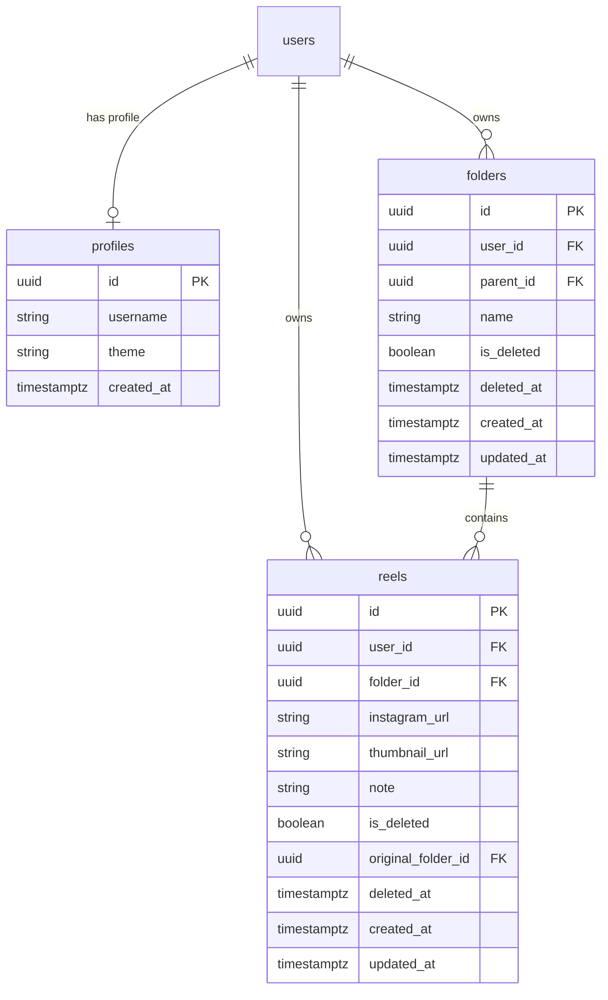

# 🎬 Reel Manager

A sleek, premium, developer-grade web application to save, organize, and browse Instagram Reel links in a visual flashcard-and-folder system. Inspired by **Vercel's** clean monochromatic aesthetic and **Obsidian's** card layouts, Reel Manager acts as a personal Pinterest board built specifically for Reels.


---

## ✨ Features

- **🔐 Supabase Authentication & Profile System**
  - Sign in or sign up securely using email and password.
  - Automatic profile generation on signup.
  - Automatic 6-hour session expiration check for security.

- **📁 Nested Folder Organization**
  - Create and manage folder groups for different topics (e.g., *Recipes*, *Design Inspiration*, *Workouts*).
  - Quick-search filter for folders.
  - Breadcrumb and browser-compatible navigation history with custom back/forward UI controls.

- **📸 Portrait-Ratio Reel Flashcards (9:16)**
  - Hover effects with premium Vercel-like hover borders and card outlines.
  - Click to play the Reel directly on Instagram.
  - **Inline Editing**: Double-click any note on a card to edit and update it directly in the database.

- **⚡ Dual-Engine Thumbnail Scraper & Proxy**
  - Uses a **Python script with `instaloader`** to scrape and download high-resolution thumbnails locally (saved under `public/thumbnails/`).
  - Fallbacks automatically to **Instagram oEmbed API** if scraper encounters rate limits, and finally to curated **Unsplash design placeholders**.
  - Internal `/api/proxy-image` server routing to bypass Instagram's CORS and referrer protection.

- **🗑️ Soft Delete & Recycle Bin**
  - Deleting a card moves it to the Recycle Bin instead of deleting it permanently.
  - Keeps deleted reels for **7 days** before automatic expiration.
  - Features single-item restore and checkboxes for multi-select batch-restore or batch-delete.

- **🌗 Persistent Theme Settings**
  - Toggle light and dark mode smoothly.
  - Theme preference is stored in the database per-user and persists across browser refreshes.

---

## 🛠️ Tech Stack & Architecture

- **Frontend Core**: [React 19](https://react.dev/), [Vite](https://vite.dev/), [TypeScript](https://www.typescriptlang.org/)
- **State & Context**: React Context APIs (`AppContext`, `ContextMenuContext` for right-click utilities)
- **Styling**: [Tailwind CSS v4](https://tailwindcss.com/) & Custom CSS Variables (supporting HSL system, high-contrast borders, and glassmorphism dialogs)
- **Database / Auth**: [Supabase](https://supabase.com/) (PostgreSQL + Row Level Security policies)
- **Scraper / Downloader**: Python 3 (using `instaloader` & `requests`)
- **Icons**: [Lucide React](https://lucide.dev/)

---

## 📂 Project Structure

```text
Reel_Manager/
├── .venv/                  # Local Python virtual environment for scraping
├── public/                 # Static assets
│   └── thumbnails/         # Cached Instagram reel thumbnails
├── scripts/
│   └── get_thumbnail.py    # Python instaloader script
├── src/
│   ├── components/         # Common UI Components
│   │   ├── ContextMenu/    # Custom context menu component
│   │   └── Layout/         # Sidebar navigation, header, and wrappers
│   ├── constants/          # Configuration values, UI definitions, and route mappings
│   ├── contexts/           # React contexts (Auth, folders, theme state)
│   ├── lib/
│   │   └── supabase/       # Supabase client initializer
│   ├── pages/              # Primary Pages (Login, Dashboard, Folder View, Recycle Bin)
│   ├── utils/              # Utility loggers and helpers
│   ├── App.tsx             # Main entry router & route protectors
│   ├── index.css           # Global Tailwind and Vercel dark/light theme definition
│   └── main.tsx            # DOM Render Entry
├── supabase_schema.sql     # Database SQL script (tables, profiles, triggers, RLS)
├── supabase_update.sql     # Database schema update patches
├── vite.config.ts          # Vite Configuration with custom API routes (/api/thumbnail, /api/proxy-image)
└── package.json            # NPM dependencies
```

---

## 💾 Database Schema

The application relies on three main tables with **Row Level Security (RLS)** active. Users can only read, write, and delete rows belonging to their own `user_id`.



---

## 🚀 Setup & Local Development

### 1. Prerequisites
- **Node.js** (v18 or higher)
- **Python 3** (with `pip`)
- A **Supabase** account (Free tier is perfect)

### 2. Database Configuration
1. Create a new project in **Supabase**.
2. Go to the **SQL Editor** tab and execute the contents of `supabase_schema.sql` (and optionally `supabase_update.sql`).
3. Under **Project Settings → API**, note the project `URL` and `Anon key`.

### 3. Environment Setup
1. Copy or create `.env` and `.env.local` files in the project root:
   ```env
   VITE_SUPABASE_URL=https://your-project-id.supabase.co
   VITE_SUPABASE_ANON_KEY=your-supabase-anon-key
   NEXT_PUBLIC_INSTAGRAM_OEMBED_TOKEN=your-facebook-oembed-access-token # (Optional)
   ```

### 4. Install Dependencies
```bash
# Install frontend dependencies
npm install

# Setup Python Virtual Environment and install packages
python -m venv .venv
# On Windows:
.venv\Scripts\activate
# On macOS/Linux:
source .venv/bin/activate

pip install instaloader requests
```

### 5. Running the Application
Start the local development server:
```bash
npm run dev
```
Open [http://localhost:3000](http://localhost:3000) in your browser.

- Vite runs the frontend and exposes two local endpoints:
  - `POST /api/thumbnail`: Runs the local Python scraping script to retrieve the reel owner's username and caches the thumbnail.
  - `GET /api/proxy-image`: Proxies external requests to bypass CORS restrictions.

---

## 🎨 UI Styling Customization

Styles are controlled via Tailwind CSS and CSS variables declared in `src/index.css`. The color system adopts high-contrast monochromatic values for dark mode and clean paper/clay values for light mode:
- **Dark Mode**: Background `#000000`, Card Surface `#141414`, Border `#2A2A2A`.
- **Light Mode**: Background `#FFFFFF`, Card Surface `#FFFFFF`, Border `#EAEAEA`.

Hover micro-animations and custom dark-theme dialog boxes are defined under the `.reel-card` and `.modal` selectors.
